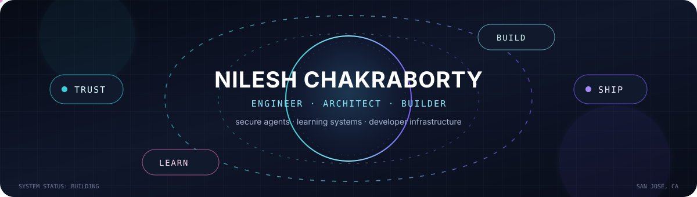

<p align="center">
  
</p>

<p align="center">
  
</p>

<p align="center">
  <a href="https://talosprotocol.com"></a>
  <a href="https://linkedin.com/in/chakrabortynilesh"></a>
  <a href="https://x.com/cnilesh90"></a>
</p>

## Hello, I’m Nilesh

I’m a Principal Engineer at Salesforce and the founder and owner of
[Talos Protocol](https://github.com/talosprotocol). I build systems across
the whole path from protocol and backend design to product UX, infrastructure,
testing, and operations.

My recurring themes are secure AI-agent communication, local and hybrid AI,
developer automation, distributed systems, and tools that make difficult ideas
easier to understand. That same systems mindset guides my work on Streambert
and other cross-platform systems: reproduce the real problem, make the smallest
durable change, and test it where it actually runs.

```text
design the contract  →  build the system  →  test the failure modes  →  ship the fix
```

## Featured impact

<table>
  <tr>
    <td width="100%" valign="top">
      <sub>FLAGSHIP / FOUNDER &amp; OWNER</sub>
      <h3>Talos Protocol</h3>
      <p>
        A security, communication, and trust layer for autonomous AI agents.
        Talos brings decentralized identity, capability-based authorization,
        encrypted agent-to-agent channels, policy enforcement, and verifiable
        audit trails into one contract-driven system.
      </p>
      <p>
        The work spans protocol contracts, a Rust security core, SDKs, gateway
        and audit services, MCP/A2A integration, observability, resilience, and
        a production control plane.
      </p>
      <p>
        <a href="https://talosprotocol.com"><strong>Website</strong></a>
        ·
        <a href="https://github.com/talosprotocol"><strong>Organization</strong></a>
        ·
        <a href="https://github.com/talosprotocol/talos"><strong>Source</strong></a>
      </p>
    </td>
  </tr>
</table>

## Products and applied systems

| Project | What it does | Core ideas |
| --- | --- | --- |
| **[Codenium](https://github.com/nileshchakraborty/codenium)** · **[Live](https://codenium.vercel.app/)** | Makes algorithms and interview patterns visual through step-by-step animation, AI tutoring, multi-language execution, and a library of 250+ problems. | TypeScript · React · Node.js · visualization · AI-assisted learning |
| **[Bazzite](https://github.com/ublue-os/bazzite)** · **[4 merged PRs](https://github.com/ublue-os/bazzite/pulls?q=is%3Apr+author%3Anileshchakraborty+is%3Amerged)** | Upstream fixes validated on a ROG Xbox Ally X, covering Steam input, Plasma keyboard behavior, Game Mode news channels, and scoped OpenGamepadUI diagnostics. | Linux · gaming handhelds · Steam · KDE Plasma · hardware validation |
| **[MindFlip AI](https://github.com/nileshchakraborty/mindflipai)** | A clean-architecture study system for generating flashcards and quizzes with local-first and hybrid model runtimes. | TypeScript · Ollama · WebLLM · GraphQL · queues and caching |
| **[Appointment Notifier](https://github.com/nileshchakraborty/appointment-notifier)** | Watches appointment signals, filters noise, deduplicates events, and delivers alerts across Telegram, email, SMS, WhatsApp, and iMessage. | Python · SQLite · Docker · OCR · multi-channel automation |
| **[AIDOC](https://github.com/nileshchakraborty/ai-health-tracker)** | A privacy-first health assistant that combines local AI, wearable data, GraphQL, and a mobile client. | TypeScript · React Native · Ollama · Oura · local AI |
| **[WebShield](https://github.com/nileshchakraborty/webshieldip)** | An assessment-integrity platform built around probabilistic signals, challenge-response anchors, explicit privacy controls, and governance. | Python · TypeScript · Postgres · Qdrant · Neo4j |

## More things I’ve shipped

- **[PDF Manager](https://github.com/nileshchakraborty/pdf-manager)** — conversion, compression, merging, editing, export, and browser-based PDF workflows.
- **[Concierge Agent](https://github.com/nileshchakraborty/concierge-ai-agent)** — a modular FastAPI assistant with search, browsing, local-model summarization, retries, circuit breakers, and dependency diagnostics.
- **[Blockchain Messaging Protocol](https://github.com/nileshchakraborty/blockchain-messaging-protocol)** — an experimental P2P messaging framework using signatures, end-to-end encryption, and ledger-backed integrity.
- **[Flutter + p5 boilerplate](https://github.com/nileshchakraborty/flutter-p5-boilerplate)** — a bridge between Flutter applications and creative-coding sketches across mobile and web.
- **[littleosbook](https://github.com/nileshchakraborty/littleosbook)** — an earlier C and Assembly exploration of kernels, bootstrapping, and systems fundamentals.

<details>
<summary><strong>The longer arc</strong></summary>

I started with Java services, web applications, mobile experiments, sentiment
analysis, and a small operating-system implementation. That foundation grew
into cloud platforms, DevOps automation, full-stack TypeScript and Python
products, local AI, agent protocols, and open-source systems work.

[Browse all public repositories →](https://github.com/nileshchakraborty?tab=repositories)

</details>

## Engineering toolbox

<p align="center">
  
</p>

<p align="center">
  
</p>

I’m happiest working where product behavior meets systems constraints:

- security boundaries, contracts, identity, and authorization;
- high-throughput services, resilience, observability, and cloud delivery;
- AI orchestration, local inference, retrieval, and human-centered learning;
- reproducible debugging across applications, operating systems, and hardware.

## Let’s collaborate

I’m interested in engineering-heavy open-source work around agent security,
developer tools, AI infrastructure, learning systems, and cloud automation. If
you are building something ambitious in one of those spaces, I’m always happy
to compare notes or review a difficult systems problem.

## Activity

<p align="center">
  
</p>

<picture>
  <source media="(prefers-color-scheme: dark)" srcset="https://raw.githubusercontent.com/Platane/snk/output/github-contribution-grid-snake-dark.svg" />
  <source media="(prefers-color-scheme: light)" srcset="https://raw.githubusercontent.com/Platane/snk/output/github-contribution-grid-snake.svg" />
  
</picture>

<p align="center">
  <sub>Build deeply. Test honestly. Leave the system better than you found it.</sub>
</p>
